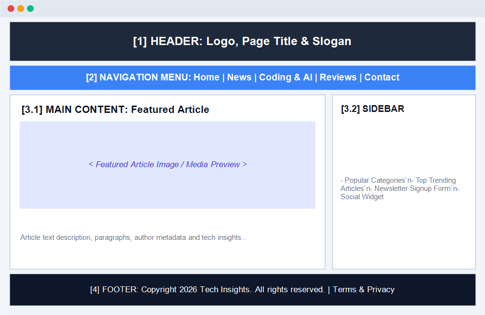

# [Bài tập] Phân tích và Xây dựng Cấu Trúc Website Template

Dự án bài tập thực hành **Phân tích và Xây dựng Cấu Trúc Website Template**, nhằm hiểu rõ vai trò của từng phần trong một giao diện web mẫu, nắm vững cách tổ chức tệp/thư mục và rèn luyện kỹ năng triển khai giao diện chuẩn bằng HTML & CSS.

---

## 🎯 Mục Tiêu Bài Tập

1. **Hiểu rõ vai trò** của từng khối thành phần cốt lõi trong một Website Template:
   - **Header** (Đầu trang)
   - **Navigation Menu** (Thanh điều hướng)
   - **Content Section** (Khu vực nội dung chính)
   - **Footer** (Chân trang)
2. **Nắm vững cách tổ chức thư mục và file** trong một dự án web chuyên nghiệp.
3. **Triển khai thực tế** bằng HTML5 ngữ nghĩa và CSS thuần, đảm bảo bố cục gọn gàng, cân đối và tương thích đa thiết bị.

---

## 📑 PHẦN 1: PHÂN TÍCH CẤU TRÚC TRANG WEB THỰC TẾ

Trang web được chọn để phân tích: **Tech Insights / TechCrunch Blog** (Trang tin tức và kiến thức công nghệ hiện đại).

### 1. Bảng phân tích chi tiết 4 thành phần chính:

| Khối thành phần | Vị trí hiển thị | Vai trò & Mục đích sử dụng | Các yếu tố thành phần bên trong |
| :--- | :--- | :--- | :--- |
| **1. Header** | Nằm ở đỉnh cao nhất của trang web | Định vị thương hiệu, tạo ấn tượng ban đầu cho người dùng | Logo trang web, Tiêu đề chính trang web (`h1`), Câu khẩu hiệu (Slogan), thông tin ngày tháng/tìm kiếm |
| **2. Navigation Menu** | Nằm ngay dưới Header (ghim cố định sticky) | Cung cấp lộ trình điều hướng thông suốt cho người xem qua các trang con | Thanh menu với 6 mục liên kết: *Trang chủ*, *Tin công nghệ*, *Lập trình & AI*, *Đánh giá sản phẩm*, *Hướng dẫn*, *Liên hệ* |
| **3. Content Section** | Chiếm không gian trung tâm lớn nhất của trang | Truyền tải giá trị cốt lõi, tin tức và nội dung chuyên môn | **Bố cục 2 cột linh hoạt (Split Layout)**:<br>• *Cột chính (Main - 70%)*: Bài viết tiêu điểm, hình ảnh minh họa chất lượng cao, các đoạn văn bản phân tích.<br>• *Cột phụ (Sidebar - 30%)*: Danh mục bài viết, bài xem nhiều, form nhận bản tin. |
| **4. Footer** | Nằm ở vị trí cuối cùng toàn trang | Cung cấp thông tin pháp lý, bản quyền và liên kết điều hướng phụ | Tuyên bố bản quyền tác giả (`© 2026 Tech Insights. All rights reserved.`), liên kết Điều khoản dịch vụ, Chính sách bảo mật |

---

### 2. Sơ đồ Wireframe Bố Cục Trang Web:

```plaintext
+-----------------------------------------------------------------------+
|                             [1] HEADER                                |
|          Logo Thương Hiệu  •  Tiêu Đề Trang Web  •  Slogan            |
+-----------------------------------------------------------------------+
|                        [2] NAVIGATION MENU                            |
|    Trang chủ | Tin công nghệ | Lập trình & AI | Đánh giá | Liên hệ    |
+-----------------------------------------------------------------------+
|                                                                       |
|   +------------------------------------+   +----------------------+   |
|   |         [3.1] MAIN CONTENT         |   |    [3.2] SIDEBAR     |   |
|   |  - Tiêu đề bài viết tiêu điểm      |   |  - Chuyên mục hot    |   |
|   |  - Thông tin tác giả & ngày đăng   |   |  - Bài đọc nhiều     |   |
|   |  - [ HÌNH ẢNH MINH HỌA BÀI VIẾT ]  |   |  - Form đăng ký email|   |
|   |  - Các đoạn văn bản phân tích      |   |                      |   |
|   |  - Nút xem chi tiết                |   |                      |   |
|   +------------------------------------+   +----------------------+   |
|                                                                       |
+-----------------------------------------------------------------------+
|                             [4] FOOTER                                |
|        Bản quyền © 2026 Tech Insights  |  Chính sách bảo mật          |
+-----------------------------------------------------------------------+
```

---

### 3. Ảnh Chụp Màn Hình Phân Tích Cấu Trúc Trang Web Mẫu:

Tệp ảnh phân tích trực quan đã được lưu trữ tại: [`images/original-website-screenshot.png`](images/original-website-screenshot.png).



---

## 💻 PHẦN 2: XÂY DỰNG LẠI BỐ CỤC BẰNG HTML & CSS

### 📁 Cấu Trúc Thư Mục Dự Án:
```plaintext
d:/BaiTapGithub/
├── index.html                           # Cấu trúc HTML chính với Header, Nav, Main, Footer
├── style.css                            # Toàn bộ mã CSS định dạng bố cục và phân chia cột
├── images/
│   ├── original-website-screenshot.png  # Ảnh chụp màn hình phân tích cấu trúc trang web mẫu
│   ├── featured-article.jpg             # Hình ảnh minh họa bài viết tiêu điểm
│   └── post-thumb.jpg                   # Hình ảnh thumbnail thanh bên Sidebar
├── README.md                            # Báo cáo phân tích và hướng dẫn dự án
└── .gitignore                           # Tệp cấu hình loại trừ file rác Git
```

---

## 💡 Các Kỹ Thuật CSS Bố Trí Bố Cục Được Sử Dụng

1. **Flexbox Layout**:
   - Navigation Menu căn giữa với `display: flex; justify-content: center;`.
   - Content Section chia 2 cột với `display: flex; gap: 30px;` (Cột chính `flex: 7`, Sidebar `flex: 3`).
   - Footer căn chỉnh dàn hàng với `display: flex; justify-content: space-between; align-items: center;`.
2. **Sticky Navigation**:
   - `position: sticky; top: 0; z-index: 1000;` giúp thanh điều hướng luôn bám đỉnh khi cuộn trang.
3. **Responsive Breakpoints**:
   - Tự động chuyển đổi layout 2 cột sang 1 cột xếp chồng trên màn hình Tablet & Mobile (`@media (max-width: 900px)`).

---

## 🚀 Hướng Dẫn Chạy Thử Nghiệm

1. Mở file [index.html](file:///d:/BaiTapGithub/index.html) trực tiếp bằng trình duyệt (Chrome, Edge, Firefox).
2. Hoặc mở qua tiện ích mở rộng **Live Server** trong VS Code / Antigravity IDE:
   - Chuột phải vào `index.html` chọn **Open with Live Server**.
   - Truy cập địa chỉ `http://127.0.0.1:5500/index.html`.

---

## 👨‍💻 Thông Tin Học Viên

- **Học viên**: dtc245200059
- **Email**: dtc245200059@ictu.edu.vn
- **Bài tập**: Phân tích và Xây dựng Cấu Trúc Website Template
